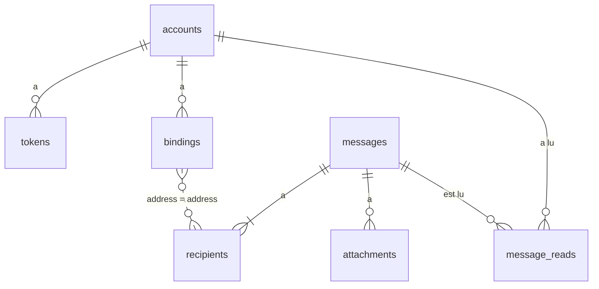

# Modèle de données

MySQL 8.4 (InnoDB, `utf8mb4`) pour les métadonnées, fichiers sur disque pour le contenu des Messages ([ADR 0005](adr/0005-mysql-plutot-que-sqlite.md), [ADR 0007](adr/0007-contenu-sur-disque.md)). Les migrations de `migrations/` reprennent ce schéma.

## Schéma



La relation pointillée n'est pas une clé étrangère : un Binding et un Destinataire se rejoignent par l'adresse, ce qui permet de lier une adresse avant ou après la réception de ses Messages.

## Tables

Conventions :

- Identifiants : UUIDv7 en `CHAR(36) CHARACTER SET ascii`, générés par l'API.
- Dates : `DATETIME(3)` en UTC. La connexion PDO fixe `time_zone = '+00:00'`.
- Adresses : `VARCHAR(254)` en collation `utf8mb4_bin`, toujours écrites en minuscules. La collation par défaut (`utf8mb4_0900_ai_ci`) confondrait `josé@` et `jose@`.

```sql
CREATE TABLE accounts (
  id         CHAR(36) CHARACTER SET ascii NOT NULL,
  name       VARCHAR(100) NOT NULL,
  role       ENUM('admin', 'user', 'bot') NOT NULL,
  created_at DATETIME(3) NOT NULL,
  PRIMARY KEY (id),
  UNIQUE KEY accounts_name (name)
);

CREATE TABLE tokens (
  id         CHAR(36) CHARACTER SET ascii NOT NULL,
  account_id CHAR(36) CHARACTER SET ascii NOT NULL,
  name       VARCHAR(100) NOT NULL,
  hash       CHAR(64) CHARACTER SET ascii NOT NULL, -- SHA-256 hexadécimal du jeton
  created_at DATETIME(3) NOT NULL,
  PRIMARY KEY (id),
  UNIQUE KEY tokens_hash (hash),
  FOREIGN KEY (account_id) REFERENCES accounts (id) ON DELETE CASCADE
);

CREATE TABLE bindings (
  account_id CHAR(36) CHARACTER SET ascii NOT NULL,
  address    VARCHAR(254) COLLATE utf8mb4_bin NOT NULL,
  PRIMARY KEY (account_id, address),
  KEY bindings_address (address),
  FOREIGN KEY (account_id) REFERENCES accounts (id) ON DELETE CASCADE
);

CREATE TABLE messages (
  id           CHAR(36) CHARACTER SET ascii NOT NULL,
  from_address VARCHAR(254) COLLATE utf8mb4_bin NOT NULL,
  from_name    VARCHAR(255) NULL,
  subject      VARCHAR(998) NOT NULL DEFAULT '',
  sent_at      DATETIME(3) NULL,
  received_at  DATETIME(3) NOT NULL,
  PRIMARY KEY (id),
  KEY messages_received_at (received_at)
);

CREATE TABLE recipients (
  message_id CHAR(36) CHARACTER SET ascii NOT NULL,
  address    VARCHAR(254) COLLATE utf8mb4_bin NOT NULL,
  name       VARCHAR(255) NULL,
  PRIMARY KEY (message_id, address),
  KEY recipients_address (address),
  FOREIGN KEY (message_id) REFERENCES messages (id) ON DELETE CASCADE
);

CREATE TABLE attachments (
  message_id   CHAR(36) CHARACTER SET ascii NOT NULL,
  part_id      SMALLINT UNSIGNED NOT NULL,
  filename     VARCHAR(255) NOT NULL,
  content_type VARCHAR(255) NOT NULL,
  size         INT UNSIGNED NOT NULL,
  PRIMARY KEY (message_id, part_id),
  FOREIGN KEY (message_id) REFERENCES messages (id) ON DELETE CASCADE
);

CREATE TABLE message_reads (
  account_id CHAR(36) CHARACTER SET ascii NOT NULL,
  message_id CHAR(36) CHARACTER SET ascii NOT NULL,
  PRIMARY KEY (account_id, message_id),
  KEY message_reads_message (message_id),
  FOREIGN KEY (account_id) REFERENCES accounts (id) ON DELETE CASCADE,
  FOREIGN KEY (message_id) REFERENCES messages (id) ON DELETE CASCADE
);
```

Table technique, tenue par `Shared\Migrator` (`GET /v1/setup`) :

```sql
CREATE TABLE schema_migrations (
  version    VARCHAR(100) NOT NULL, -- nom du fichier, ex. 001_comptes.sql
  applied_at DATETIME(3) NOT NULL,
  PRIMARY KEY (version)
);
```

## Fichiers

```
storage/messages/{id}/text             la partie texte, si text n'est pas null
storage/messages/{id}/html             la partie HTML, si html n'est pas null
storage/messages/{id}/parts/{partId}   chaque pièce jointe, décodée
```

`storage/` est hors du dossier public. Le nom d'un fichier ne vient jamais du client (`filename` reste en base), donc aucun chemin ne peut sortir de `storage/`.

Invariant : **une ligne `messages` implique que ses fichiers existent**.

- Dépôt : écrire les fichiers, puis insérer les lignes dans une transaction ; si la transaction échoue, supprimer le dossier.
- Suppression (`DELETE` et purge, même code) : supprimer la ligne `messages` (les cascades emportent `recipients`, `attachments` et `message_reads`), puis le dossier.
- Une interruption laisse au pire un dossier orphelin, sans ligne : invisible et sans effet.

## Requêtes clés

Messages visibles par un Compte `user` (un `admin` n'a pas la condition `EXISTS`) :

```sql
SELECT m.*,
       EXISTS (SELECT 1 FROM attachments a WHERE a.message_id = m.id) AS has_attachments,
       NOT EXISTS (SELECT 1 FROM message_reads mr
                   WHERE mr.message_id = m.id AND mr.account_id = :account) AS unread
FROM messages m
WHERE EXISTS (SELECT 1
              FROM recipients r
              JOIN bindings b ON b.address = r.address
              WHERE r.message_id = m.id AND b.account_id = :account)
  -- ?to=     AND EXISTS (SELECT 1 FROM recipients r2 WHERE r2.message_id = m.id AND r2.address = :to)
  -- ?since=  AND m.received_at >= :since
  -- ?unread= AND [NOT] EXISTS (SELECT 1 FROM message_reads mr WHERE mr.message_id = m.id AND mr.account_id = :account)
ORDER BY m.received_at DESC, m.id DESC
LIMIT :limit OFFSET :offset;
```

Marquage lu, à chaque `GET /v1/messages/{id}` :

```sql
INSERT IGNORE INTO message_reads (account_id, message_id) VALUES (:account, :message);
```

Authentification :

```sql
SELECT a.id, a.role FROM tokens t JOIN accounts a ON a.id = t.account_id WHERE t.hash = :sha256;
```

Purge, par lots de 500 jusqu'à épuisement :

```sql
SELECT id FROM messages WHERE received_at < UTC_TIMESTAMP(3) - INTERVAL 30 DAY LIMIT 500;
```
